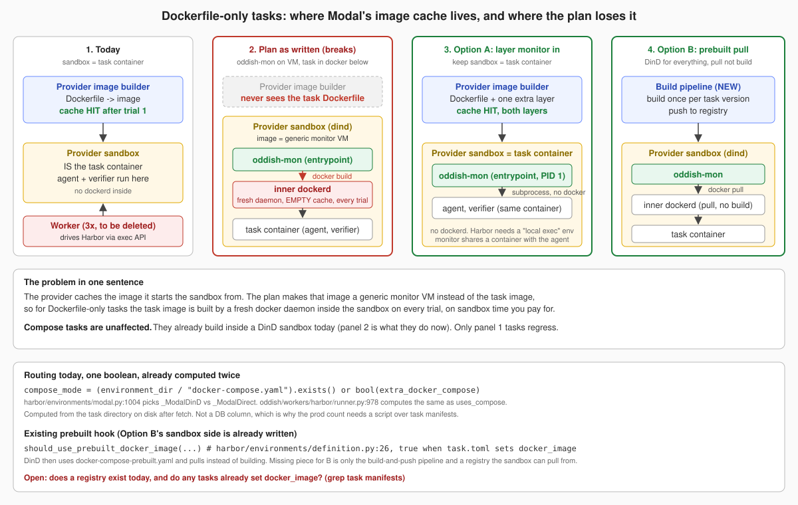

# Images and warm-up

A task's environment is a Dockerfile or a Compose file. Something has to build those images, and where that happens decides who pays for it.

## Why it matters

Inside a fresh sandbox the Docker store is empty, so without a cache every oddish-mon trial would rebuild its images in a billed sandbox. On a preview in September one task spent 154 seconds in setup on each of its first three trials and 0.7 to 3.1 seconds on the next eight.

## How the warm-up works

Shipped to production on 24 September 2026.

1. The launcher looks up a snapshot for the task version. The key hashes the provider, the task version, the sandbox size and the snapshot base: the monitor image, the entrypoint, the dependency lock and the warm recipe files. Code outside the recipe does not change the key; the boot swaps in the launcher's current code bundle instead, so deploys do not throw snapshots away.
2. On a miss, the launcher runs a warm-up sandbox: it fetches the task, builds every image including Compose services, keeps the task files, stops Docker cleanly and snapshots the disk. Other trials of the same version wait for that warm-up instead of booting cold; the wait is capped at 30 minutes, after which a trial boots plain. A warm-up that fails is retried once, then the trial boots cold and builds inline.
3. On a hit, the trial's sandbox boots from the snapshot, verifies the images locally and tells Harbor to use its prebuilt path. Setup drops from minutes to about a second.
4. Snapshots serve for seven days.

The warm-up is priced as its own line in the cost ledger since 24 September, charged to the trial that triggered it, so its cost is visible and counted toward quotas.

## Measured

- A repeat trial boots the warm snapshot and builds nothing: 8 of 8 tasks on staging.
- Five trials at once on a fresh task: one warmed, four waited, none cold.
- Per task version, about 11 trials on average, the warm-up removes 82 to 86% of billed setup seconds. The task's own image build is 75 to 80% of each warm-up; the warm-up's own overhead is 40 to 80 seconds.
- In production during the first four days of October, 13% of monitor trials paid a warm-up, and the warm-up amortised to about 1% of a CPU trial's compute.

## Decisions

- The warm-up blocks the first trial of a version; running it beside a cold first trial would trade about 10% of the saving for 40 to 80 seconds of latency.
- Single-trial tasks still warm: almost every task version runs again later.
- Daytona's warm-up is off since 24 September (snapshot quota); Daytona launches were disabled entirely on 28 September.
