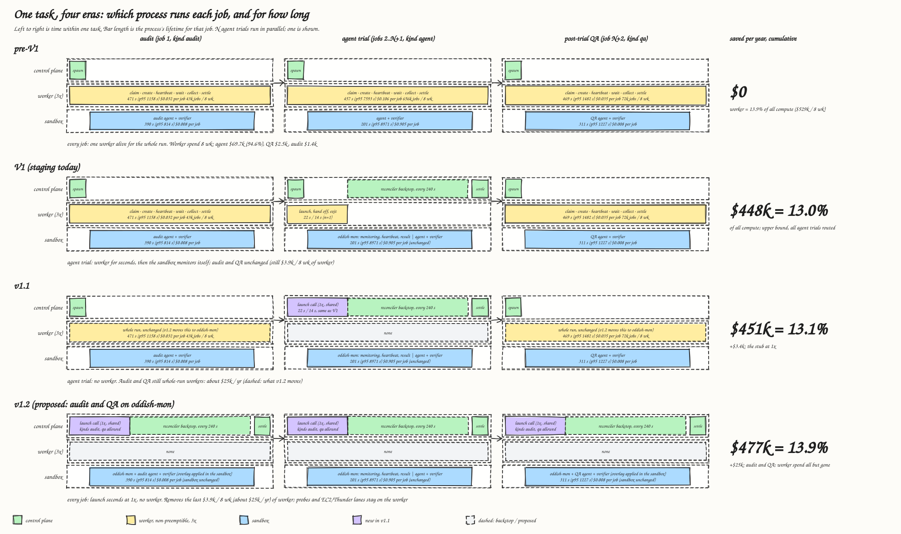

# Costs and how to measure

How Oddish prices compute, which numbers this report uses, and how to reproduce them.

## One task across the eras

Before oddish-mon, every job in a task held a worker for its whole run. Now an agent trial holds one for seconds and the sandbox supervises itself; audit and QA jobs are unchanged. Per-job durations and costs on the drawing are the eight-week ledger averages.

## The ledger

Oddish keeps its own compute ledger, the `modal_costs` table. Every compute span is one row with a component role, the trial and job it belongs to, start and finish, the resources requested and a priced cost. The roles:

| Role | What it prices | Old path | oddish-mon |
| --- | --- | --- | --- |
| worker_function | the Modal function that holds the trial | the watcher, for the whole trial | the launcher, about 20 seconds |
| agent_sandbox | the sandbox the trial runs in | the task sandbox | the monitor sandbox, verifier included |
| verifier_sandbox | a separate verifier box | yes | not used; the verifier runs inside the sandbox |
| warmup_sandbox | the one-off image build per task version | none | since 24 September |

Prices come from a rate card: per core-second and per GiB-second for functions and sandboxes, per second for each GPU type, with a 3x multiplier on non-preemptible functions. The card was last checked against Modal's price list in July 2026.

The ledger is an estimate of the invoice, not the invoice. The cloud bill dashboard, Catfish, shows what Modal actually charged, by Modal app and day. It cannot split a trial into parts; the ledger can. Percentages from the ledger travel better than dollars until the two are reconciled.

## Which path a trial took

The job row carries a monitor token hash only on the oddish-mon path. Joining the ledger to the job row by job id and testing that column splits every span by path. Trial kind matters: the old path records audit and QA analysis sandboxes as agent_sandbox too, so filter to agent trials when comparing.

## The three denominators

The same saving is a different percentage depending on what it is divided by. Always say which.

| Denominator | Watcher share | Use it for |
| --- | --- | --- |
| one CPU agent trial on Modal, old path, 3 October | 37% | per-trial comparisons |
| all priced compute, GPU included, 8 weeks to 20 September | 14% | fleet-wide compute framing |
| total spend including model tokens, same 8 weeks | 3.7% | the share of the company's bill |

## The queries

Kept beside the report in the Oddish notes, read-only, parameterised by a window start.

1. Cost per finished trial by path and component, for a window. The watcher's per-trial cost on the old path minus the launcher's on the new path is the saving per trial; subtract the warm-up per launch.
2. The same split by trial kind, which is what exposed the audit and QA contamination.
3. Daily raw cost by path and component since 22 September, and a second statement that computes the per-day saving: monitor trials priced at that day's watcher rate, minus actual launcher and warm-up cost, with the monitor share and the percent of CPU-trial compute saved.
4. Route share by attempt and status per day, which checks that first attempts split as configured and shows failure and cancellation rates per path.

Production database reads are run by a person with access; the queries are written so the output can be pasted back and read.

## What the numbers showed

See [Rollout and results](../results.md) for the figures. In short: the watcher cost 37% of a CPU trial; the launcher and warm-up together cost 2%; the monitor sandbox costs no more than the old sandbox; per day, 7 to 13% of Modal CPU-trial compute was avoided at 40 to 70% sampling.
